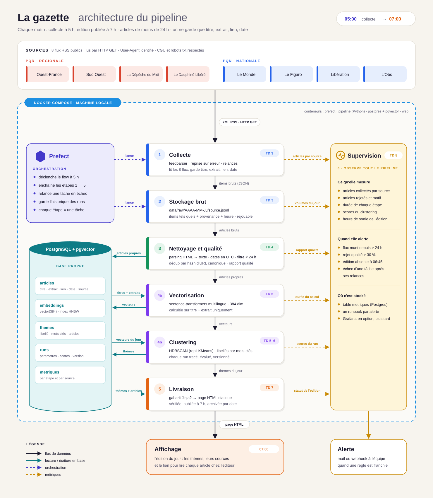

# Architecture — La gazette

> **Mise à jour (2026-10-21) — stack effectivement implémentée.** L'orchestration est assurée par
> **Apache Airflow 3** (LocalExecutor) et non par Prefect. Le stockage brut est un **fichier JSON par
> source et par jour** (`data/raw/<date>/<pqr|pqn>/<slug>.json`) avec un `_manifest.json`, et non du
> JSON Lines. PostgreSQL 16 + pgvector héberge la base `airflow` et la base `gazette`. Il y a
> **8 sources** (4 PQR, 4 PQN). Le reste du document décrit la cible des étapes suivantes.

Pipeline quotidien : les flux RSS de la presse sont collectés à 5 h, regroupés par thèmes, puis l'édition est publiée à 7 h. Tout tourne en local sous Docker Compose et Prefect orchestre les étapes.

Version image : [`architecture.png`](architecture.png).

## Ce qui circule entre les boîtes

| Étape | Entrée | Sortie | Format |
|---|---|---|---|
| Collecte | flux RSS des 8 sources | items bruts | XML puis JSON |
| Stockage brut | items bruts | un fichier par source et par jour | JSON Lines (`.jsonl`) |
| Nettoyage | fichiers bruts du jour | articles propres, rapport qualité | lignes de la table `articles` |
| Vectorisation | titre + extrait | un vecteur par article | colonne `vector(384)` (pgvector) |
| Clustering | vecteurs du jour | thèmes, libellés, articles affectés | tables `themes` et `runs` |
| Livraison | thèmes du jour | édition datée | HTML statique archivé |
| Supervision | métriques de chaque étape | alertes | table `metriques`, mail ou webhook |

## Choix de format

- **Brut en JSON Lines daté** : une ligne par item, lisible, facile à rejouer. Si une étape aval casse, on la relance sans recontacter les éditeurs.
- **PostgreSQL + pgvector pour le propre** : articles, vecteurs et thèmes dans une seule base. Les recherches de similarité se font en SQL.
- **HTML statique pour l'édition** : aucun serveur applicatif nécessaire, l'archive devient une simple suite de fichiers datés.

## Où ça tourne

Les conteneurs Docker Compose sont `prefect`, `pipeline` (Python) et `postgres` (avec pgvector), plus un petit serveur web pour l'affichage. Ils tournent sur les machines de l'équipe jusqu'à la fourniture de l'infrastructure de production (TD 4 ou 6).
