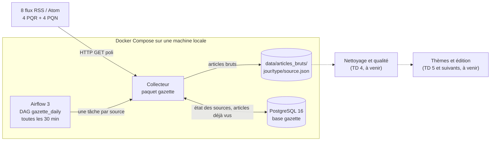

# Architecture — La gazette

> **Mise à jour du 2026-11-12.** Ce document décrit ce qui est **réellement implémenté** : la collecte des flux RSS/Atom, le stockage brut et le suivi de l'état des sources. Les étapes suivantes (nettoyage, thèmes, édition) sont marquées « à venir ». Les champs et les tables sont décrits dans [`donnees.md`](donnees.md).

La gazette collecte toutes les 30 minutes les flux de 8 titres de presse (4 régionaux, 4 nationaux), garde pour chaque article le titre, un extrait, le lien, la date et la rubrique, puis range le tout sans doublon. Tout tourne en local sous Docker Compose, sur la machine d'un membre de l'équipe.

## Vue d'ensemble

## Ce qui circule entre les boîtes

| Étape | Statut | Entrée | Sortie | Format |
|---|---|---|---|---|
| Collecte | fait | 8 flux RSS 2.0 / Atom | articles bruts | XML puis objets Python |
| Stockage brut | fait | articles bruts | un fichier par source et par jour, plus un manifeste | JSON (`data/articles_bruts/`) |
| Suivi des sources | fait | résultat de chaque collecte | dernière réussite, échecs consécutifs, mise en sommeil | tables `sources` et `articles_vus` |
| Nettoyage et qualité | à venir (TD 4) | fichiers bruts | articles propres, rejets, rapport | tables PostgreSQL, rapport markdown |
| Vectorisation et thèmes | à venir (TD 5) | titre + extrait | vecteurs, thèmes | colonne `vector` (pgvector) |
| Édition | à venir | thèmes du jour | édition datée | HTML statique |
| Supervision | à venir (TD 8) | métriques | alertes | à définir |

## Les briques

### Collecte (`src/gazette/collect/`)
- **Parseur** : `feedparser`, qui lit RSS 2.0 et Atom. On ne garde que le titre, l'extrait, le lien, la date, la rubrique et un `payload` construit par liste blanche. Jamais le texte intégral, ni auteur, ni commentaire.
- **Identité d'un article** : `sha256(source + lien canonique)`. Le lien canonique est sans fragment, sans paramètres de suivi (`utm_*`, `xtor`…). Le `guid` du flux n'est pas utilisé, car il n'est pas fiable partout.
- **Politesse** (`PoliteFetcher`) : User-Agent qui identifie le projet et donne un e-mail de contact, vérification du `robots.txt`, pause de 2 s entre deux requêtes vers un même domaine, timeout de 20 s, requêtes conditionnelles (`ETag` / `Last-Modified`).
- **Reprise** : 3 essais avec attente croissante sur les erreurs passagères (réseau, 429, 5xx). Un 404, un `robots.txt` qui interdit ou un flux illisible sont des erreurs permanentes : pas de relance.

### Stockage brut (`src/gazette/storage/`)
- Un fichier JSON par source et par jour : `data/articles_bruts/<AAAA-MM-JJ>/<pqr|pqn>/<slug>.json`, avec un `_manifest.json` par jour (statut, articles reçus, écrits, ignorés, durée, par source).
- Écriture **atomique** (fichier temporaire puis `os.replace`) et verrou sur le fichier : un plantage ne laisse jamais un JSON tronqué.
- Chaque passage de collecte ajoute une entrée dans `fetches` du fichier du jour et n'écrase rien. L'historique des passages est conservé.

### Base `gazette` (`src/gazette/db/`)
PostgreSQL 16 avec l'extension pgvector. Le schéma est créé par des **migrations SQL numérotées** (`001` à `003`), suivies dans la table `schema_migrations`.
- `sources` : une ligne par flux, avec `actif`, `derniere_reussite`, `echecs_consecutifs`, `etag` et `last_modified`. Elle est amorcée depuis `sources.csv`, puis c'est la base qui fait foi.
- `articles_vus` : les identifiants des articles déjà écrits. Ils servent à dédupliquer **d'un jour à l'autre**. Les articles eux-mêmes restent en JSON.
- `sources_en_sommeil` : une vue des sources qui ne sont plus interrogées.

### Mise en sommeil
Une collecte en échec incrémente `echecs_consecutifs`, et une réussite le remet à 0. À **3 échecs de suite**, la source n'est plus interrogée. Quelqu'un doit le voir : la vue `sources_en_sommeil`, le statut `sleeping` dans le manifeste, un avertissement à chaque passage et `python -m gazette sources list`. Le réveil se fait avec `python -m gazette sources wake <slug>`.

### Orchestration (`dags/gazette_daily.py`)
Le DAG Airflow ne contient **aucune logique métier** : il appelle les fonctions du paquet `gazette`, qui marchent aussi sans Airflow (`python -m gazette collect`).

| Tâche | Rôle |
|---|---|
| `collection_date` | jour de collecte (heure de Paris) |
| `list_sources` | sources actives et pas en sommeil, lues en base |
| `collect` | **une tâche par source** (task mapping), 2 relances avec attente croissante |
| `write_manifest` | écrit le manifeste, **même si des sources ont échoué** (`trigger_rule="all_done"`) |

Réglages : cron `*/30 * * * *` en heure de Paris, `catchup=False`, un seul run à la fois, `dagrun_timeout` de 25 min. Un **pool à 1 place** (`gazette_editeurs`) garantit une seule requête à la fois, donc jamais deux requêtes simultanées vers un même éditeur. Un échec n'est compté dans `echecs_consecutifs` qu'au dernier essai Airflow, pour ne pas mettre une source en sommeil à cause d'une panne passagère.

Le DAG s'appelle encore `gazette_daily` (nom historique, conservé pour garder l'historique des runs), alors qu'il tourne toutes les 30 minutes.

### Où ça tourne
Docker Compose, sur une seule machine : `postgres` (exposé sur `localhost:5433` pour la collecte hors Docker), `airflow-init` (migrations, amorçage de `sources`, création du pool, puis il s'arrête), `airflow-apiserver` (interface sur `localhost:8080`), `airflow-scheduler` et `airflow-dag-processor`. La pile est réglée pour une machine de 8 Go (parallélisme limité) et met environ 3 à 4 minutes à démarrer à froid.

### Tests et CI
- **Tests** : `pytest` sans accès à Internet : flux RSS et Atom locaux, transport HTTP simulé, et un vrai serveur HTTP local qui renvoie un 503. Les tests de la base ont besoin d'un PostgreSQL et sont ignorés sans lui.
- **CI GitHub Actions** : ruff et pytest avec un service PostgreSQL, puis validation du `docker-compose.yml`, construction de l'image, initialisation des bases (`airflow-init`) et contrôle du DAG dans l'image (`tests/check_dag.py`).

## Pourquoi Airflow

Le besoin : collecter 8 sources toutes les 30 minutes, **sans qu'une source en panne bloque les autres**, avec des relances, une trace de chaque passage, et un résultat **relançable** par n'importe quel membre de l'équipe.

| Besoin | Comment Airflow y répond ici |
|---|---|
| Isoler les pannes | une tâche par source (task mapping) : un flux qui échoue n'empêche pas les 7 autres |
| Reprise sur erreur | relances avec attente croissante, sans écrire de boucle à la main |
| Ne pas surcharger un éditeur | pool à 1 place : une seule collecte à la fois |
| Voir ce qui s'est passé | interface web : historique des runs, journaux par source, échecs visibles |
| Manifeste même en cas d'échec | `trigger_rule="all_done"` |
| Planifier en heure de Paris | cron avec fuseau horaire, `catchup=False`, un seul run à la fois |
| Relançable | `docker compose up -d` suffit ; `python -m gazette collect` fait la même chose sans Airflow |

**Alternatives écartées.**
- **Un `cron` qui lance un script** : plus simple, mais il faudrait réécrire à la main l'isolation par source, les relances, l'historique et la visibilité des échecs.
- **Prefect** (prévu dans le schéma d'origine) : il saurait aussi faire la collecte. Nous avons retenu Airflow pour son modèle de tâches mappées, ses pools et son interface d'historique, qui correspondent exactement aux besoins ci-dessus, et parce que c'est l'orchestrateur le plus répandu dans les équipes data.

**Ce que ça coûte.** Airflow est lourd : environ 4 Go de mémoire, un démarrage à froid de plusieurs minutes, et un `LocalExecutor` limité à une machine. Le contrôle du DAG en CI demande aussi la base de métadonnées d'Airflow (d'où l'étape `airflow-init`). Pour 8 flux toutes les 30 minutes c'est surdimensionné en puissance, mais ça prépare la suite : l'orchestrateur devra enchaîner nettoyage, contrôles de qualité, vectorisation et édition.

## Limites connues
- **Une seule machine** : si elle est éteinte ou si Docker s'arrête, la collecte s'arrête. L'infrastructure de production viendra plus tard.
- **Le DAG est créé en pause** : il faut l'activer une fois dans l'interface Airflow.
- **`data/` n'est pas versionné** : les articles collectés ne sont pas dans Git, chaque machine a les siens.
- **Pas encore de durée de rétention** du brut : à écrire avec le TD 4.
- **Pas de contrôle de qualité** : le brut peut contenir publi-reportages, horoscopes, titres vides, etc. C'est l'objet du TD 4.

## Pour la suite : brancher le nettoyage
- **Entrée** : les fichiers `data/articles_bruts/<date>/<type>/<slug>.json`. L'`id` de chaque article est stable et sert de clé pour tout ce qui suit.
- **Sortie** : de nouvelles tables PostgreSQL ajoutées par migration (`004_…`, `005_…`), qui gardent l'`id` de l'article brut pour retrouver l'item d'origine.
- **Code** : le dossier `src/gazette/clean/`, aujourd'hui vide. Les règles et les transformations y sont des fonctions simples, testées sur des fixtures, sans appel réseau.
- **Orchestration** : une tâche du DAG après `write_manifest`.

## Schéma d'origine
[`architecture.svg`](architecture.svg) montre la cible dessinée au départ du projet. Il est **dépassé** sur trois points : l'orchestrateur n'est pas Prefect mais Airflow, le brut est en JSON par source et par jour (et non en `.jsonl`), et la collecte a lieu toutes les 30 minutes (et non à 5 h). Pour les étapes à venir (nettoyage, vectorisation, thèmes, édition), il reste une bonne référence.
